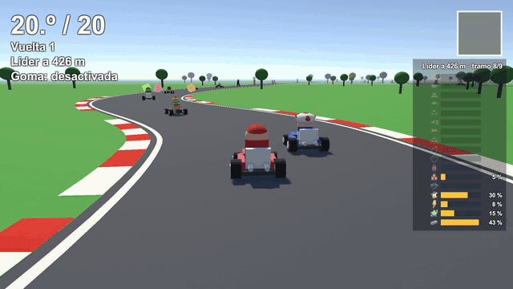

# Mario Kart te hace trampas (a favor y en contra)

> La misma caja te da una moneda si vas primero y una bala si vas último. Y los rivales corren más o menos según cómo vayas tú.

## Qué muestra este proyecto
Una carrera de karts con 20 pilotos en la que se ven los dos sistemas que la igualan, y que normalmente no se ven:

1. **La ruleta de objetos.** El objeto no sale al azar sin más: sale de una tabla de pesos que depende de tu
   situación. En esta recreación cuenta la distancia al primero, no el puesto. La gráfica enseña en directo las
   probabilidades de tu tramo:

   | Distancia al líder | Qué puede salir |
   |---|---|
   | Menos de 12 m | Moneda 35 %, plátano 32,5 %, disco verde 25 % |
   | Desde 95 m | Aparece la bala (5 %) |
   | Entre 375 y 750 m | Bala 42,5 %, plátano 0 % |

   Los rivales tienen su propia tabla: en ese último tramo, su bala se queda en el 27,5 %.

2. **La goma de la IA (rubber banding).** Cada rival mira a qué distancia está de ti y cambia su velocidad máxima:
   si va lejos por detrás acelera por encima de lo normal, y si va demasiado por delante levanta el pie. Con la goma
   apagada (tecla **G**) la carrera se rompe y la distancia con el segundo crece sin parar.

3. **La dificultad es la tensión de la goma.** El sistema no cambia, cambian sus números:

   | Nivel | Velocidad extra máxima | Frenado máximo | Dónde quiere estar el mejor rival |
   |---|---|---|---|
   | Fácil | +15 % | −35 % | 25 m detrás de ti |
   | Normal | +30 % | −20 % | 12 m detrás de ti |
   | Difícil | +50 % | −10 % | 8 m delante de ti |

   El nivel también decide cuánto se apartan los rivales de su trazada y lo bien que usan los objetos.

4. **Con dos jugadores, ¿a quién persigue la IA?** La ruleta es por jugador, pero la goma necesita un objetivo. La
   escena de pantalla partida compara cuatro reglas con un jugador primero y otro último:

   | Regla | Qué pasa |
   |---|---|
   | Al primero | Todo el pelotón va a por el que va delante; el otro corre solo |
   | Al más cercano | El pelotón se parte en dos y hay rivales que cambian de objetivo |
   | A la media | Los rivales acaban en tierra de nadie, entre los dos |
   | Mitad y mitad | Cada rival tiene asignado a uno de los dos jugadores |

**Qué es real y qué no.** Las probabilidades son las tablas de Mario Kart 8 (Wii U, v4.1, Gran Premio) publicadas en
Mario Wiki; las de Deluxe no están publicadas. Los objetos que no existen aquí se quitan y su peso se reparte entre
los demás. Los metros son una escala propia: las unidades del juego no tienen equivalencia conocida, así que
26 000 unidades equivalen a media vuelta de este circuito (1,5 km). La goma **no está documentada por Nintendo**: es
como se suele hacer, no como lo hace Mario Kart.

Todo lo que sale en pantalla es propio: los pilotos son cápsulas de Unity "disfrazadas", los karts están hechos con
primitivas y los objetos son inventados, cada uno con el papel de uno del juego para poder usar sus tablas. No se
usa código ni assets de Nintendo.

## Vídeo
_(Enlace al vídeo completo cuando se publique.)_

## Cómo probarlo
1. Clona el repositorio.
2. Ábrelo con **Unity 6000.6.4f1** (plantilla Universal 3D / URP).
3. Abre una escena de `Assets/_Project/Scenes` y pulsa Play:
   - `00_Circuito`: un jugador contra 19 rivales.
   - `01_DosJugadores`: pantalla partida, con Mario arriba y Luigi abajo.

Las dos escenas arrancan con el piloto automático puesto, para que puedas mirar sin conducir. Para llevar tú el kart,
desmarca `autopilot` en el componente `RaceBootstrap`.

### Controles
| Tecla | Qué hace |
|---|---|
| W, A, S, D | Conducir (jugador 1; si juegas solo, también las flechas) |
| E | Usar el objeto (jugador 1) |
| Flechas / Intro | Conducir / usar el objeto (jugador 2) |
| G | Goma sí / no |
| 1, 2, 3 | Fácil, Normal, Difícil |
| B | Capa: gomas entre cada rival y lo que persigue |
| R | Capa: ritmo de cada rival (% sobre su velocidad) |
| Z | Capa: zona de la pista donde quieren estar los rivales |
| O | Capa: gráfica de probabilidades de tu ruleta |
| T | Capa: trazada de la IA |
| V | Cámara de persecución / mirando atrás al pelotón |
| C | Regla de persecución (dos jugadores) |
| K | Choques entre karts sí / no |

También se juega con mando: gatillos para acelerar y frenar, stick izquierdo para girar y A para usar el objeto. Con
dos jugadores, cada uno usa su mando.

Los objetos de momento solo se ven en la ruleta: al usarlos se vacía el hueco, pero no tienen efecto en la carrera.

En `RaceBootstrap` también están el ritmo del piloto automático (`autopilotPace` y `secondAutopilotPace`), la dispersión
del pelotón y la semilla de la ruleta. Los números de cada dificultad se editan en
`Assets/_Project/ScriptableObjects/Difficulty`.

## Estructura
El código sigue una arquitectura por capas, cada una con su asmdef (`KartRace.<Capa>`) y dependencias solo hacia dentro:

- `Assets/_Project/Scripts/Domain` — C# puro, sin `UnityEngine`: la pista y su regla de distancias (`TrackLine`), la
  conducción y la IA (`KartMotion`, `AiPilot`, `AiRoute`), la ruleta (`ItemTable`, `ItemRoulette`), la goma
  (`RubberBand`) y las reglas de persecución (`IChaseRule`).
- `Assets/_Project/Scripts/Application` — casos de uso: `AdvanceKarts`, `OpenItemBox`, `RubberBanding` y
  `UseRivalItems`.
- `Assets/_Project/Scripts/Presentation` — lo que se ve, solo leyendo: HUD, ruleta, gráfica de probabilidades, gomas
  y pantalla partida.
- `Assets/_Project/Scripts/Infrastructure` — Unity: el punto de arranque (`RaceBootstrap`), el input (`DemoInput`), la
  simulación de los karts y los perfiles de dificultad.
- `Assets/_Project/Scripts/Editor` — generan el circuito, los karts, los iconos y las escenas con primitivas y
  código (**Tools > Kart Race**).
- `Assets/_Project/Scripts/Tests/EditMode` — tests de Domain y Application.
- `Docs` — imágenes y GIFs del README.

## Licencia
MIT — consulta [LICENSE](LICENSE).
